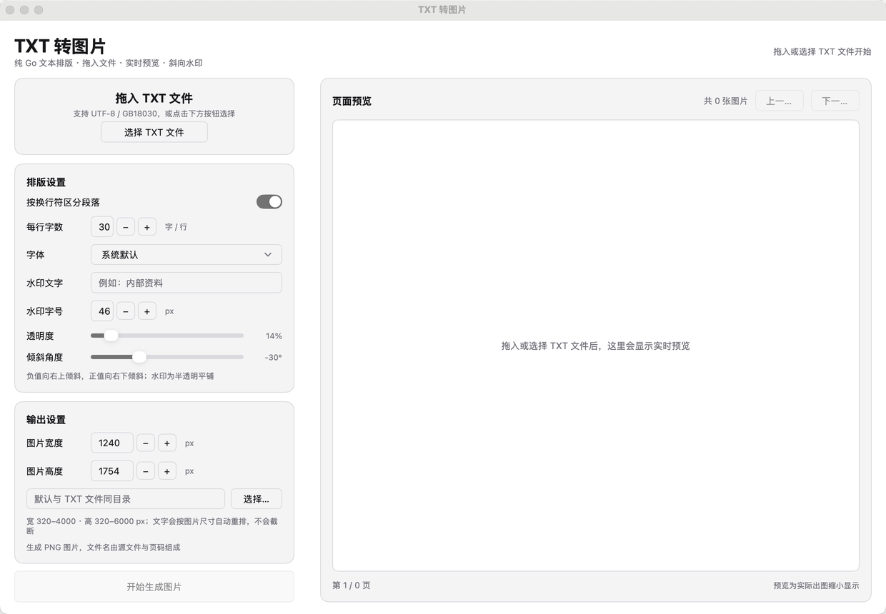

# TXT 转图片

使用 Go 与 [MyGo](https://github.com/egoist/mygo) 原生 UI 编写的桌面工具：把 TXT 文本按可配置排版转换成多张 PNG 图片，支持拖入文件、实时预览、系统字体选择与斜向平铺水印。

## 界面预览



## 功能

- 选择或拖入 `.txt` 文件，可一键清空已选文件
- 可切换是否按换行符区分段落
- 可配置每行字数（1–100）
- 可输入输出图片宽度与高度（320–4000 × 320–6000 px）
- 自动选择系统字体，也可从系统字体列表切换
- 选择图片输出目录，默认与 TXT 文件同目录
- 实时预览实际出图效果，显示图片总数与页码
- 可输入水印文字，支持调整水印字号、透明度与倾斜角度（默认斜向平铺）
- 反 OCR 增强：形变扭曲、字距挤压、笔画重影、干扰纹理，每项提供开关与强度调节
- 支持 UTF-8（含 BOM）、UTF-16（含 BOM）与 GB18030 文本
- 支持批量生成 PNG 图片或导出单个 PDF 文件
- PDF 权限加密：可设打开密码与权限密码，禁止打印、复制文字、提取图片
- 导出压缩包：可打包全部 PNG，ZIP 内置 AES-256 加密，7z 支持密码与文件头加密
- 支持导出 Word（`.docx`），按当前段落设置生成，标题加粗、首行缩进
- Word 转 PDF：左侧拖入或选择 `.docx`，用 LibreOffice 转 PDF 后逐页渲染并叠加斜向平铺水印，再写出带水印的 PDF
- PDF 转图片：拖入 `.pdf`，用 go-fitz（MuPDF）按 150 / 300 DPI 逐页导出 PNG，支持页码范围
- 转换 / 导出全程进度条，显示百分比与当前页
- 生成完成后弹出成功提示

## 技术架构

```
main.go       应用状态、MyGo 原生界面、预览调度与 PNG 导出
render.go     文本分行分页、字体栅格化、页面绘制、水印旋转平铺
pdf.go        纯 Go PDF 写入：逐页渲染为 RGB 图像并嵌入 PDF
pdfcrypt.go   PDF 标准安全处理器：RC4 128 位加密、/O /U /P 与权限位
docx.go       纯 Go Word 导出：OOXML 打包、段落与字体设置
word.go       Word 转 PDF：调用 LibreOffice 排版，纯 Go 渲染每页并叠加水印后写出 PDF
pdf2img.go    PDF 转图片：go-fitz 打开 PDF，按 DPI 逐页渲染 PNG
archive.go    压缩包导出：内置 AES-256 ZIP，或调用系统 7-Zip 生成加密 7z
fonts.go      系统字体探测、字体列表扫描、TTC/TTF/OTF 字体解析缓存
textfile.go   TXT 编码识别与解码
mygo.json     MyGo 应用配置
resources/    应用图标与界面截图
```

- **UI**：MyGo `ui` 原生控件，纯 Go，无 WebView。
- **文本排版**：按字符数换行、按换行符形成段落，并根据图片尺寸与每行字数自适应字号、边距与分页；尺寸变化时自动重排，不截断文字。
- **图片渲染**：`golang.org/x/image/font/opentype` 栅格化系统字体，`image.RGBA` 绘制页面，纯 Go 输出 PNG。
- **PDF 导出**：复用同一套分页、字体、尺寸和水印参数，逐页栅格化后以 Flate 压缩的 RGB 图像流写入 PDF；默认按 150 DPI 映射页面尺寸。
- **Word 导出**：纯 Go 生成 OOXML `.docx`，沿用「按换行符区分段落」设置；正文宋体小四、1.5 倍行距、首行缩进两字，日记头加粗。设置水印后会生成一张 A4 平铺水印图，放进页眉并置于正文之下，效果与图片版一致；反 OCR 需要逐字变形，Word 文字稿不支持。
- **PDF 加密**：采用 PDF 标准安全处理器（V2 / R3，RC4 128 位），支持打开密码与权限密码，可禁止打印、复制文字与提取图片。

### PDF 权限加密

- **打开密码**：打开文档时需要输入；留空则打开时无需密码。
- **权限密码**：用于修改权限；与打开密码分开设置，留空时回退为打开密码。
- **禁止打印 / 禁止复制文字 / 禁止提取图片**：勾选后写入 PDF 的 `/P` 权限位。
- 加密仅在设置了任一密码后启用；只勾选禁止项而不设密码时不会导出，界面会提示先设置密码。
- PDF 标准把「复制文字」与「提取图片」合并为同一个权限位，禁止其中任意一项都会同时限制另一项。
- 水印与反 OCR 仍会照常绘制，加密只限制阅读器的复制、打印与提取行为，不能阻止截图；忽略权限的第三方工具仍可能解开内容。

### 导出压缩包

- **ZIP**：使用内置的 AES-256 加密，纯 Go 实现，跨平台可用；密码留空则不加密。
- **7z**：调用系统 7-Zip 命令行（`7zz` / `7z` / `7za`），需要另行安装；设置密码时会同时加密文件头（`-mhe=on`），未安装时界面会提示。
- 压缩包内包含按当前设置渲染的全部 PNG 图片，文件名与图片导出规则一致。
- 未设置密码时也能压缩，只是不加密。
- 7z 的密码会作为命令行参数传给 7-Zip，在本机进程列表中可能短暂可见；需要更高安全性时建议使用 ZIP 或先加密磁盘。
- **水印**：把水印文字绘制到透明图层，按可调角度旋转后平铺到页面底层，字号与透明度均可配置。
- **反 OCR**：按页派生确定性随机种子，逐字做旋转、缩放、错切与重叠，叠加弹性波浪扭曲、重影、干扰线与噪点；预览、PNG 与 PDF 输出保持一致。
- **字体支持**：扫描 macOS / Windows / Linux 系统字体目录，支持 `.ttf`、`.otf`、`.ttc`、`.otc`，解析后的字体文件会缓存复用。
- **实时预览**：设置变更后做防抖后台渲染，只生成当前页的缩放预览，避免阻塞 UI；导出时逐页后台生成并更新进度。
- **编码**：优先 UTF-8；失败时用 `x/text` 的 GB18030 解码，同时处理 UTF-16 BOM。

## Word 转 PDF

顶部切到「Word 转 PDF」，在左侧拖入 `.docx` / `.doc` 或点「选择 Word 文件」：

1. 选择文件后，先调用本机 LibreOffice 的 `soffice --headless` 把 Word 转成临时 PDF，读出总页数。
2. 右侧显示页面预览，可逐页翻看；预览也会叠加当前水印设置。
3. 在「转换范围」里填起始页和结束页（点「全部」恢复整本），再点「开始转换」。
4. 用纯 Go 的 PDF 渲染器按 150 DPI 渲染选中页，A4 约 1240 × 1754 像素。
5. 按当前水印设置叠加斜向平铺文字，字号会随页面宽度等比缩放。
6. 逐页写成图片型 PDF，保存到 Word 文件旁的 `<文件名>.pdf`，同名覆盖。

选择文件不会自动开始转换；换文件或改水印后需要重新点「开始转换」。保留原文档的字体、表格、分页、页眉页脚和图片；只导出选中的页码。LibreOffice 转换超时 3 分钟，最多 500 页。水印文字留空则不加。

部分导出工具（如 WPS）会给每个段落都写一个「随文文本框」标记（`w:framePr`），LibreOffice 会因此把正文拆成一页一段，页面上只剩标题。转换前会自动复制一份并清掉这类标记，原文件不会被改动。

首次使用如果提示未检测到 LibreOffice，在左侧点「安装 LibreOffice」会打开系统浏览器，安装后点「重新检测」即可，不需要重启应用。也可以用环境变量 `SOFFICE_PATH` 指定 `soffice` 的路径。

## PDF 转图片

顶部切到「PDF 转图片」，在左侧拖入 `.pdf` 或点「选择 PDF 文件」：

1. 选择文件后立即用 go-fitz（MuPDF）打开，读出总页数。
2. 右侧显示页面预览，可逐页翻看。
3. 在「转换范围」里填起始页和结束页（点「全部」恢复整本）。
4. 在「输出」里选分辨率：150 DPI 适合屏幕阅读，300 DPI 适合打印。
5. 点「开始转换」，逐页渲染并保存到 PDF 同目录的 `<文件名>_images` 文件夹。

文件名按真实页码补零，如只转第 3–5 页会得到 `_003.png` 到 `_005.png`。已有同名文件会被覆盖；单次最多 500 页。加密 PDF 暂不支持。

## 环境要求

- Go **1.27.3+**
- Word 转 PDF 需要本机安装 LibreOffice（`soffice`），否则左侧会显示安装入口
- PDF 转图片使用 go-fitz，打包或开发时都要打开 CGO（见上方构建命令）
- 导出 7z 压缩包时需要系统已安装 7-Zip 命令行（如 `brew install sevenzip`）；ZIP 无需额外依赖
- asdf 用户可使用项目内的 `.tool-versions`：

```bash
asdf install golang 1.27.3
asdf set golang 1.27.3
go version
```

如果使用 GoLand，请把项目 Go SDK / GOROOT 切换为 asdf 的 `1.27.3`，否则 MyGo 会触发工具链下载并可能因 `GOSUMDB=off` 失败。

## 运行

```bash
go mod tidy
go run .
```

开发时也可以直接用 `CGO_ENABLED=1 go tool mygo dev`；打包用 `CGO_ENABLED=1 go tool mygo build`。应用是原生 UI，不再需要 Node.js 或前端构建。

`mygo` 默认关闭 CGO，而 go-fitz 依赖 MuPDF 静态库，所以涉及 MyGo 的命令要显式打开 `CGO_ENABLED=1`，否则 PDF 转图片会在运行时找不到 `libmupdf.dylib`。

## 构建桌面应用

```bash
CGO_ENABLED=1 go tool mygo build
```

产物位于 `build/`。也可以直接用 `go build` 编译当前平台的命令行可执行文件（默认已启用 CGO）。

## 打包可独立运行的执行文件

用项目根目录的 `package.sh` 一步出包，产物在 `dist/`：

```bash
./package.sh                 # universal（arm64 + x86_64）zip 包
./package.sh --dmg           # 同时生成 dmg 安装镜像
./package.sh -p darwin/arm64 # 只打 Apple Silicon，体积更小
./package.sh --verify-run    # 打完做启动冒烟测试
./package.sh --open          # 打完直接打开
./package.sh --stop          # 结束残留的 TXT2Img 进程
./package.sh --clean         # 先删 dist/ 再打包
```

产物：

- `dist/<平台>/TXT2Img.app` —— 双击即用，不需要 Go 环境和任何依赖
- `dist/TXT2Img-<version>-macos-<arch>.zip` —— 解压即用，可直接发给别人
- `dist/<平台>/txt2img-<version>.dmg` —— 加 `--dmg` 时生成

脚本做的事：

1. 检查 Go / clang / Xcode 工具链，强制 `CGO_ENABLED=1`（go-fitz 的 MuPDF 是静态库，必须 cgo）
2. 清理残留进程，调用 `go tool mygo build` 生成带 Info.plist、图标和 ad-hoc 签名的 `.app`
3. 校验产物是否真的可独立运行：架构、`otool -L` 是否只有系统库、`codesign --verify`、Info.plist 字段
4. 用 `ditto` 打包 zip（普通 `zip` 会破坏 `.app` 的签名封条）
5. `--verify-run` 会启动应用、点关闭按钮，确认关窗后进程退出、不留后台进程

> 直接 `go build` 出来的裸二进制没有 Info.plist，双击没有 Dock 图标和菜单栏，不建议作为分发产物。
>
> 关窗即退出的行为由 `main.go` 里 `a.win.OnClosed(func() { mygo.App.Quit() })` 保证：mygo 默认在最后一个窗口关闭后不退出（`applicationShouldTerminateAfterLastWindowClosed` 固定返回 `false`），单窗口应用需要自己处理，否则会留下看不到的后台进程。
>
> Word 转 PDF 依赖本机安装的 LibreOffice，这是外部程序，不随包分发。

## 开源协议

本项目基于 **非商业使用许可（Non-Commercial License）** 开源：

- ✅ 允许个人学习、研究、教学及非商业项目使用、修改和分发
- ❌ **未经作者书面授权，禁止任何形式的商业使用**（包括但不限于：销售、付费服务、商业产品集成、企业内部生产使用）
- 分发或修改后的版本必须保留本协议及版权声明
- 本项目按「现状」提供，不附带任何明示或暗示的担保

如需商业授权，请联系作者获取书面许可。
